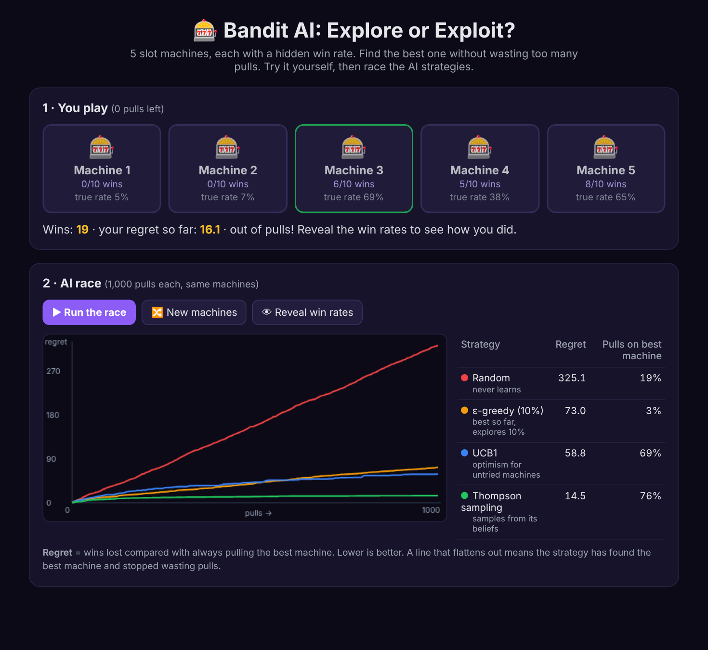

# 🎰 Bandit AI: Explore or Exploit?

Five slot machines, each with a hidden win rate. How do you find the best one without wasting pulls? This is the **multi-armed bandit** problem, the AI behind **A/B testing, ad selection and recommendation feeds**.
Play it yourself, then race 4 strategies against each other. Plain HTML and JavaScript, no libraries.



## Run it
Open `index.html` in your browser. Run the tests with `node test.js`.

## The dilemma
- **Exploit:** keep pulling the machine that's done best so far. But it might just have been lucky.
- **Explore:** try other machines. But every pull on a worse machine costs you a win.

**Regret** measures the cost: wins lost compared with always pulling the best machine.

## The strategies
| Strategy | How it decides |
|---|---|
| **Random** | Pulls any machine. Never learns (the baseline). |
| **ε-greedy** | 90% of the time, pulls the best average so far; 10% of the time, a random one. |
| **UCB1** | *Optimism:* average + a bonus `√(2 ln t / pulls)` that's large for rarely tried machines. Picks the highest. |
| **Thompson sampling** | Keeps a belief (Beta distribution) about each machine's rate, draws one plausible rate per machine, and pulls the highest. Uncertain machines sometimes draw high, so they get explored naturally. |

## Results: 200 random games × 1,000 pulls
| Strategy | Average regret ↓ | Most-pulled machine was the best |
|---|---|---|
| Random | 259.7 | 16% |
| ε-greedy | 40.0 | 85% |
| UCB1 | 68.7 | **90%** |
| **Thompson sampling** | **25.2** | 88% |

**What this shows:**
- Every learning strategy beats random by a factor of 4–10.
- **Thompson sampling** loses the fewest wins, which is why it's widely used in practice.
- **UCB** finds the best machine most reliably, but explores more carefully, which costs wins along the way.
- **ε-greedy can lock onto the wrong machine** after an early unlucky streak. In the screenshot it pulled the best machine (69%) only 3% of the time, sticking with machine 5 (65%) instead. Its regret stays moderate only because that machine was close.

## Files
```
index.html, style.css   # machines, race chart, results table
bandit.js               # strategies + Beta sampler + simulation (no DOM)
app.js                  # your game, the animated race
test.js                 # 4 tests over 200 simulated games
screenshots/
```

## License
MIT
